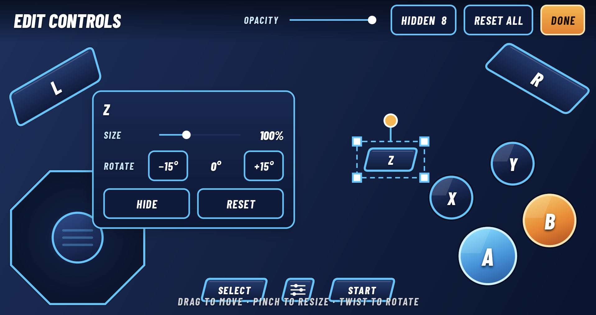
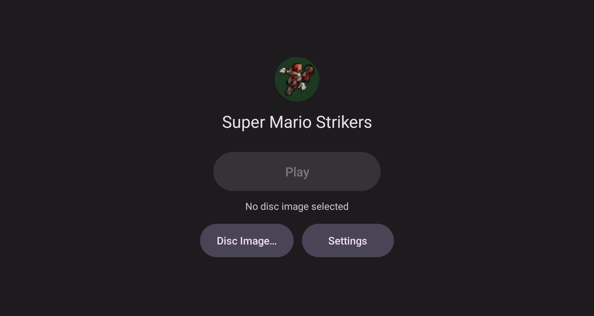

# Strikers for Android

*Super Mario Strikers*, running natively on Android phones, tablets and handhelds: no emulator, touch controls drawn for the game, controllers, local multiplayer and online play. It is the Android build of [new-coke's Strikers](https://github.com/new-coke/strikers), the native PC port built on the community decompilation, and it follows that project's releases.

You need game data from your own copy of *Super Mario Strikers*. No game assets are included.

## Where it's at (November 2026)

The whole game is playable on ARM64 devices running Android 9 or newer with Vulkan. It tracks upstream's game version, currently 2.0.0.

- **Touch controls built for Strikers.** Buttons in the style of the game's menus, with captions that follow possession: A, B and Y read Pass, Shoot and Deke when your team has the ball, and Switch, Tackle and Hit when it doesn't. X uses an item, Z beside it cycles items, L aims and R is turbo. Move, resize, rotate or hide any control, and set the overlay's opacity, in the editor. The overlay steps aside when a controller connects.

  

- **Controllers and handhelds.** Gamepads and handhelds with built-in controls work out of the box, with remappable GameCube buttons, deadzones and rumble. Back opens a settings window over the paused match; Select is the Online button.
- **Local multiplayer.** Up to four controllers, with player ports shown and swappable on Choose Sides.
- **Online play.** Rollback matches over your network or the internet, using upstream's online code. Players need the same game version and a compatible disc region (US and European discs play together).
- **Graphics.** Resolution, frame rate, anti-aliasing and performance presets; Dolphin-format texture packs; custom Vulkan drivers on supported devices; and an optional stadium haze that makes the far stands recede.
- **A simple launcher.** Pick your disc once, then press Play, or let the app open straight into the game.

  

Not on Android: Discord Rich Presence and invites (they need the desktop Discord client) and the desktop settings app (Android has its own settings).

## Play it

1. Download the APK from the [latest release](https://github.com/keewhi/strikers-droid/releases/latest) and install it. Android may ask you to allow installs from your browser or file manager.
2. Put your disc image (ISO, GCM, CISO or GCZ) somewhere on the device.
3. Open **Strikers**, tap **Disc Image…** and choose it.
4. Tap **Play**.

The [Android guide](smstrikers-port/README-android.md) covers settings, controllers, texture packs, Vulkan drivers, online play, test builds of unreleased changes, building from source and the device-testing checklist.

## Where it came from

This fork brings [new-coke's Strikers port](https://github.com/new-coke/strikers) to Android, starting from [Luis Santos's Android port](https://github.com/luisxl15/Strikers-Android-Port). The game is based on the community decompilation led by [Yannick Suter](https://github.com/yannicksuter) and uses [Aurora](https://github.com/encounter/aurora) for platform support. Android changes stay small and separate so the fork keeps pace with upstream releases.

Report Android problems in this fork's [issue tracker](https://github.com/keewhi/strikers-droid/issues), not upstream's. Include your device, Android version, APK version and the steps to reproduce; **Settings → Game → Share logs** attaches the game's log.

Licensing and third-party notices

This project contains material with different licences and rights statuses.

The upstream author’s original porting code, tools and documentation are offered under CC0 1.0, except where otherwise noted, and only to the extent that I own the relevant rights. This does not relicense third-party material or grant rights to the original game.

The main distinctions are:

- Reconstructed game code: this is an unofficial source reconstruction, not an official source release. Reconstructed material may remain subject to third-party rights; this project claims no ownership of those rights and grants no permission on behalf of their holders.
- MusyX audio middleware: the upstream decompilation carries an MIT licence, which is preserved here. That notice does not, by itself, establish that its licensors hold all rights in the reconstructed middleware.
- ODE physics: upstream ODE portions use the historical BSD-style licence preserved in the repository. That licence does not, by itself, establish the licensing status of independently copyrightable game-specific modifications.
- Button prompt artwork: [Input Prompts](https://kenney.nl/assets/input-prompts) by Kenney, under CC0 1.0. 
- Controller pictures: [Gamepad Asset Pack](https://github.com/AL2009man/Gamepad-Asset-Pack) by Al. Lopez (AL2009man), under the MIT licence, recoloured and outlined.
- Discord Rich Presence: [borealis](https://github.com/encounter/borealis) by Luke Street and [nlohmann/json](https://github.com/nlohmann/json) by Niels Lohmann, both MIT.
- Online play's encryption: [Monocypher](https://monocypher.org) by Loup Vaillant, Michael Savage and Fabio Scotoni, under CC0 1.0 or the 2-clause BSD licence.
- Router port mapping: [miniupnpc](https://miniupnp.tuxfamily.org) by Thomas Bernard, under the 3-clause BSD licence.
- Online panel font: Roboto Medium by Google, under the Apache 2.0 licence.
- Android touch controls font: [Barlow Condensed](https://github.com/jpt/barlow) by The Barlow Project Authors, under the SIL Open Font License 1.1 (licence in the APK under `assets/licenses`).
- Switch build: NVK from [mesa-switch](https://github.com/danfromtico/mesa-switch) (MIT, see 'NOTICE-NVK.md'); [libnx](https://github.com/switchbrew/libnx) (ISC); devkitPro's SDL2 (zlib), Mesa EGL/OpenGL ES and libdrm_nouveau (MIT); [sdl3on2](https://github.com/new-coke/sdl3on2) (zlib); [dawn-switch](https://github.com/new-coke/dawn-switch) (BSD 3-Clause).
- Settings app: [Qt 6](https://www.qt.io), under the LGPL 3.0.
- FreeType: portions of this software are copyright The FreeType Project (www.freetype.org). All rights reserved.
- Other third-party material and dependencies: these retain their applicable licences, and each archive includes their notices.

The project distributes source code and compiled releases. These do not include game assets; you must supply game data from your own copy. Distribution does not grant permission to reuse or redistribute third-party material beyond its applicable licences and rights.

This is an unofficial project, unaffiliated with and not endorsed by Nintendo or Next Level Games.

